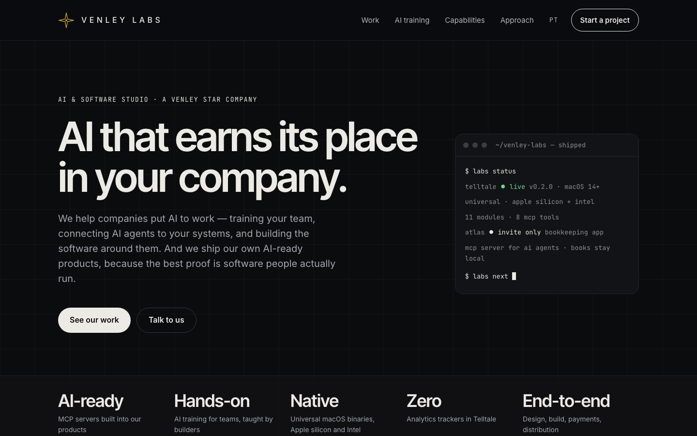
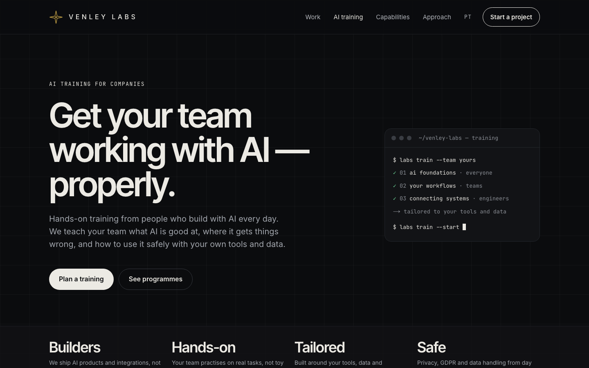
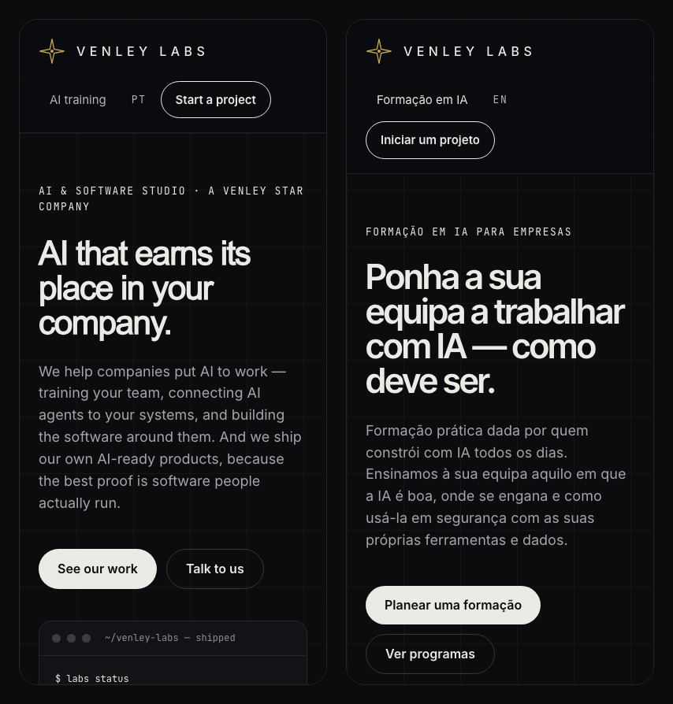

<div align="center">


# Venley Labs

**AI that earns its place in your company.**

The website of Venley Labs, the AI & software studio of Venley Star, Lda (Portugal).<br>
AI training for teams, AI and MCP integrations, and our own shipped products: Telltale and Atlas.

[venleylabs.com](https://venleylabs.com) · [geral@venleystar.com](mailto:geral@venleystar.com)


</div>

<br>



<table>
  <tr>
    <td width="62%"></td>
    <td width="38%"></td>
  </tr>
</table>

---

## Pages

| Page | English | Português | What's on it |
|---|---|---|---|
| **Home** | [`/`](https://venleylabs.com/) | [`/pt/`](https://venleylabs.com/pt/) | Hero and live terminal card · Work (Telltale, Atlas) · AI training · Capabilities · Approach · Contact |
| **AI training** | [`/training/`](https://venleylabs.com/training/) | [`/pt/formacao/`](https://venleylabs.com/pt/formacao/) | Three programmes (foundations → workflows → MCP & agents) · How it works · Topics and practical details · EU AI Act note |

Both pages are fully static, share one header and footer, and switch language in place. Every page also gets a canonical URL and `hreflang` alternates, and appears in `sitemap.xml`.

## Getting started

```bash
cd web
npm install
npm run dev       # → http://localhost:3000
```

| Command | Does |
|---|---|
| `npm run dev` | Local dev server with hot reload |
| `npm run build` | Static export to `web/out/`, ready for any static host |
| `npm run lint` | ESLint (Next.js config) |

> [!NOTE]
> The site uses `output: "export"`, so there's no Node server in production. Serve `web/out/` from any static host (Railway, Cloudflare Pages, Netlify, S3…).

## Repository layout

```text
labs/
├── design/                 Design handoff: the source of truth
│   ├── reference/index.html   approved visual reference
│   ├── content.md             original page copy
│   ├── tokens.css · .json     colours, type, spacing, radii
│   └── assets/                star mark, product and capability icons
│
└── web/                    The Next.js site
    ├── app/
    │   ├── (en)/              English root layout: /, /training/
    │   ├── (pt)/pt/           Portuguese root layout: /pt/, /pt/formacao/
    │   ├── globals.css        design tokens and base styles
    │   └── sitemap.ts · robots.ts · icon.svg
    ├── components/         One component and CSS module per section
    └── lib/
        ├── i18n/en.ts · pt.ts all page copy, typed
        ├── site.ts            domain, email, product links
        └── metadata.ts        titles, canonical, hreflang, Open Graph
```

## Editing content

All copy lives in two typed dictionaries, **`web/lib/i18n/en.ts`** and **`web/lib/i18n/pt.ts`**. `pt.ts` is typed against the English one, so a missing translation fails the build.

- **Contact email, domain, Telltale links:** `web/lib/site.ts`
- **Add a case study:** add another `<CaseStudy>` in `web/components/Work.tsx`. The `mirrored` prop puts the mockup on the other side.
- **Placeholders:** write unknown facts as `[LIKE THIS]`. They render with a dashed outline, so they can't go live unnoticed.

## Design system

The UI is dark and monochrome, with a faint 72px grid. Colour carries meaning, so the brand colours are tightly scoped:

| Token | Value | Used for |
|---|---|---|
| `--ink-950` | `#0B0C0E` | Page background |
| `--ink-900` | `#121316` | Cards, terminal |
| `--text` / `--accent` | `#ECEAE4` | Primary text, buttons, icons |
| `--text-muted` | `#A3A7AE` | Body copy (passes 4.5:1) |
| `--paper` | `#F2EFE7` | The one light band (Approach / How it works) |
| `--gold` | `#C9A646` | **Venley star mark only** |
| `--telltale-green` | `#6FD69A` | **Telltale only** |

**Type:** Inter Tight for display, Inter for body, JetBrains Mono for eyebrows, chips and terminal text. All are self-hosted through `next/font`.<br>
**Shape:** 24px cards, 16px panels, pill buttons and chips.<br>
**Motion:** one blinking terminal cursor, which stops under `prefers-reduced-motion`.

Components never hard-code colours. Everything goes through the CSS variables in `web/app/globals.css`, which mirror `design/tokens.css`.

## Accessibility

- Real links and buttons, with touch targets of at least 44px and visible focus rings.
- Decorative SVGs are `aria-hidden`. Product mockups carry a text description.
- Layouts wrap with flexbox from 1440px down to 390px, with no horizontal scroll.
- `lang` is set per locale (`en`, `pt-PT`), and the language switch is labelled in the target language.

## Open questions

- The Portuguese copy is a first draft and needs review.
- Confirm that training is delivered in Portuguese or English.
- Confirm that Telltale is built in Swift (chip copy).
- If Telltale isn't notarized at launch, point `site.telltale.download` at the Telltale site.
- Atlas is described as local-first ("the books never leave the machine"). Confirm this still holds.

---

<div align="center">
<sub>Venley Labs is part of Venley Star, Lda · Portugal · © 2026</sub>
</div>
